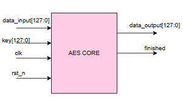
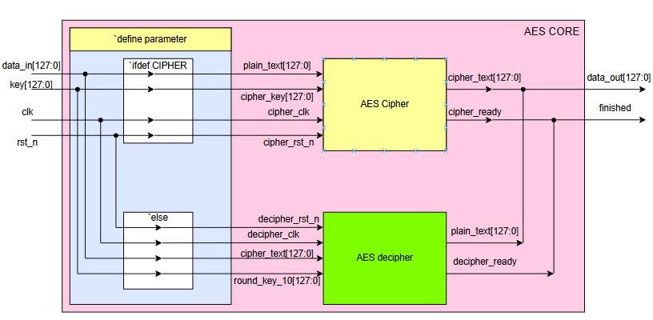
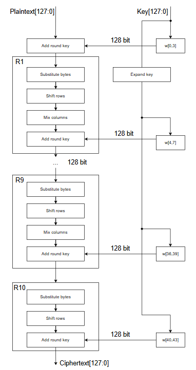
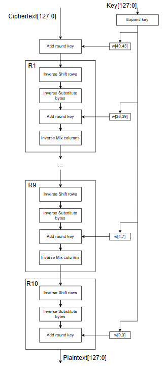
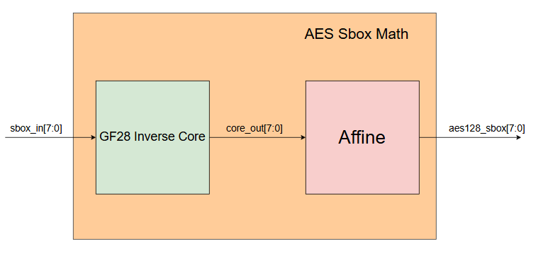
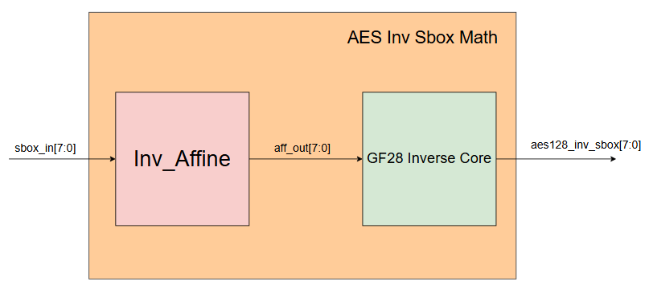
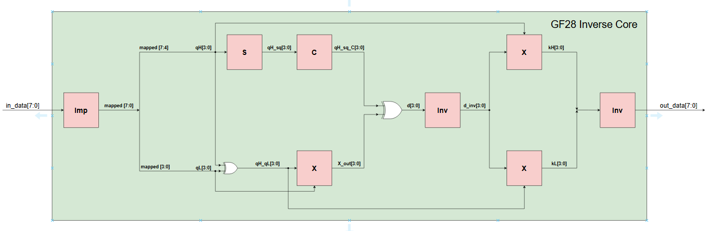
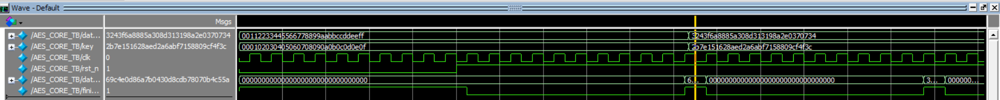

# 🔐 Hardware IP Core: 128-bit AES Cryptographic Engine (NIST FIPS 197)

[](https://en.wikipedia.org/wiki/Verilog)
[](https://csrc.nist.gov/publications/detail/fips/197/final)
[](https://www.intel.com)
[-orange.svg)]()
[](LICENSE)

> **Tác giả (Author)**: Lê Anh Khoa ([@KhoaLe246205](https://github.com/KhoaLe246205))  
> **Email liên hệ**: khoalekhoaanh2462005@gmail.com  
> **Chủ đề**: Thiết kế Lõi IP Phần Cứng Mật Mã Học Khối 128-bit AES (Mã Hóa & Giải Mã) Tối Ưu Diện Tích Silicon Bằng Số Học Trường Hữu Hạn $GF(2^8)$ Trên ASIC/FPGA.

---

## 📑 Mục Lục (Table of Contents)
1. [Tổng Quan & Cơ Sở Lý Thuyết AES-128](#1-tổng-quan--cơ-sở-lý-thuyết-aes-128)
   - [1.1. Các thông số tiêu chuẩn FIPS 197](#11-các-thông-số-tiêu-chuẩn-fips-197)
   - [1.2. Các phép biến đổi cơ bản trong vòng lặp](#12-các-phép-biến-đổi-cơ-bản-trong-vòng-lặp)
2. [Kiến Trúc Mức Đỉnh & Giao Diện Phần Cứng (Top-Level Architecture)](#2-kiến-trúc-mức-đỉnh--giao-diện-phần-cứng-top-level-architecture)
   - [2.1. Biểu tượng & Giao diện Chân (Pinout & Interface Symbol)](#21-biểu-tượng--giao-diện-chân-pinout--interface-symbol)
   - [2.2. Sơ đồ khối kiến trúc Mức Đỉnh (Top-Level Datapath & Parameterization)](#22-sơ-đồ-khối-kiến-trúc-mức-đỉnh-top-level-datapath--parameterization)
3. [Luồng Xử Lý Mã Hóa & Giải Mã (Dataflow Pipelines)](#3-luồng-xử-lý-mã-hóa--giải-mã-dataflow-pipelines)
   - [3.1. Luồng Mã Hóa Chi Tiết (AES Encryption Dataflow)](#31-luồng-mã-hóa-chi-tiết-aes-encryption-dataflow)
   - [3.2. Luồng Giải Mã Chi Tiết (AES Decryption Dataflow)](#32-luồng-giải-mã-chi-tiết-aes-decryption-dataflow)
4. [Thiết Kế Vi Kiến Trúc S-Box Bằng Số Học Trường Hữu Hạn $GF(2^8)$](#4-thiết-kế-vi-kiến-trúc-s-box-bằng-số-học-trường-hữu-hạn-gf28)
   - [4.1. Kiến trúc Khối Thay Thế Thuận (Forward S-Box: `aes_Sbox_Math`)](#41-kiến-trúc-khối-thay-thế-thuận-forward-s-box-aes_sbox_math)
   - [4.2. Kiến trúc Khối Thay Thế Nghịch (Inverse S-Box: `aes_InvSbox_Math`)](#42-kiến-trúc-khối-thay-thế-nghịch-inverse-s-box-aes_invsbox_math)
   - [4.3. Vi kiến trúc Lõi Nghịch Đảo $GF(2^8)$ (Composite Field Inversion Microarchitecture)](#43-vi-kiến-trúc-lõi-nghịch-đảo-gf28-composite-field-inversion-microarchitecture)
5. [Khối Mở Rộng Khóa Động (On-the-fly Key Expansion)](#5-khối-mở-rộng-khóa-động-on-the-fly-key-expansion)
6. [Cấu Trúc Thư Mục & Mã Nguồn RTL (Directory Tree)](#6-cấu-trúc-thư-mục--mã-nguồn-rtl-directory-tree)
7. [Kiểm Chứng Mô Phỏng & Kết Quả Sóng (Verification & Waveform Results)](#7-kiểm-chứng-mô-phỏng--kết-quả-sóng-verification--waveform-results)
   - [7.1. Phân tích Giản đồ Sóng ModelSim (Waveform Analysis)](#71-phân-tích-giản-đồ-sóng-modelsim-waveform-analysis)
   - [7.2. Hướng dẫn Tự Chạy Mô Phỏng](#72-hướng-dẫn-tự-chạy-mô-phỏng)
8. [Tài Liệu Tham Khảo (References)](#8-tài-liệu-tham-khảo-references)

---

## 1. Tổng Quan & Cơ Sở Lý Thuyết AES-128

Thuật toán **AES (Advanced Encryption Standard)** là thuật toán mật mã khối đối xứng được Viện Tiêu chuẩn và Công nghệ Quốc gia Hoa Kỳ (**NIST**) chuẩn hóa trong tài liệu **FIPS PUB 197**. Dữ liệu được tính toán trên khối ma trận trạng thái (State) 128-bit kích thước $4 \times 4$ bytes thông qua mạng SPN (Substitution-Permutation Network) bảo đảm hai tính chất bảo mật cốt lõi của Shannon: **Thay thế (Confusion)** và **Khuếch tán (Diffusion)**.

### 1.1. Các thông số tiêu chuẩn FIPS 197:
* **Độ dài khối ($N_b$)**: $N_b = 4$ words = 128 bits.
* **Độ dài khóa ($N_k$)**: $N_k = 4$ words = 128 bits.
* **Số vòng lặp ($N_r$)**: $N_r = 10$ rounds.
* **Tổng số khóa vòng sinh ra**: 11 khóa vòng 128-bit (gồm khóa vòng ban đầu $W[0..3]$ và 10 khóa vòng $W[4..43]$).

### 1.2. Các phép biến đổi cơ bản trong vòng lặp:
1. **SubBytes / InvSubBytes**: Thay thế phi tuyến từng byte độc lập thông qua cấu trúc S-Box. Đây là thành phần phi tuyến duy nhất trong thuật toán, đóng vai trò ngăn chặn các hình thức tấn công vi sai (differential) và tuyến tính (linear cryptanalysis).
2. **ShiftRows / InvShiftRows**: Dịch chuyển vòng các byte theo từng hàng của ma trận State ($4 \times 4$ bytes), tạo tính chất hoán vị liên cột.
3. **MixColumns / InvMixColumns**: Nhân ma trận từng cột State với đa thức cố định trong trường Galois, đảm bảo sau 2 rounds toàn bộ 16 bytes của State đều bị xáo trộn phụ thuộc lẫn nhau.
4. **AddRoundKey**: Cộng bitwise XOR 128-bit giữa State hiện tại với khóa vòng tương ứng.

---

## 2. Kiến Trúc Mức Đỉnh & Giao Diện Phần Cứng (Top-Level Architecture)

### 2.1. Biểu tượng & Giao diện Chân (Pinout & Interface Symbol)

Lõi IP được đóng gói thành module chuẩn với giao diện tín hiệu đồng bộ đơn giản, dễ dàng tích hợp vào hệ thống SoC hoặc vi điều khiển.

<p align="center">
  
  <br>
  <em>Hình 1: Biểu tượng mức đỉnh và các cổng giao tiếp vào/ra của AES CORE</em>
</p>

#### Bảng Đặc Tả Tín Hiệu Giao Tiếp (Interface Specifications):
| Tên Cổng (Port) | Độ Rộng (Bit) | Chiều (Direction) | Miêu Tả Chức Năng (Description) |
| :--- | :---: | :---: | :--- |
| `clk` | 1 | Input | Xung nhịp đồng bộ hệ thống (System Clock). |
| `rst_n` | 1 | Input | Tín hiệu reset tích cực mức thấp (Asynchronous active-low reset). |
| `data_input[127:0]` | 128 | Input | Bus dữ liệu đầu vào: nhận **Plaintext** (khi mã hóa) hoặc **Ciphertext** (khi giải mã). |
| `key[127:0]` | 128 | Input | Bus khóa 128-bit: **Cipher Key** gốc hoặc khóa vòng phục vụ giải mã. |
| `data_output[127:0]` | 128 | Output | Bus dữ liệu đầu ra: cung cấp **Ciphertext** hoặc **Plaintext** khôi phục được. |
| `finished` | 1 | Output | Cờ báo trạng thái: tích cực mức `1` đúng 1 chu kỳ clock khi quá trình xử lý 10 rounds hoàn tất. |

---

### 2.2. Sơ đồ khối kiến trúc Mức Đỉnh (Top-Level Datapath & Parameterization)

Module đỉnh [`aes_top`](file:///D:/Portfolio_GitHub/01_AES128_ASIC_IP_Core/rtl/design.sv) được thiết kế theo cấu trúc tham số hóa linh hoạt thông qua chỉ thị tiền xử lý (macro definition trong [`AES_Config_Parameter.sv`](file:///D:/Portfolio_GitHub/01_AES128_ASIC_IP_Core/rtl/AES_Config_Parameter.sv)). Tùy thuộc vào ứng dụng mục tiêu (cần tiết kiệm diện tích tối đa cho bộ mã hóa riêng biệt, hay tích hợp cả hai), luồng điều khiển và datapath được phân tách rõ ràng.

<p align="center">
  
  <br>
  <em>Hình 2: Sơ đồ kiến trúc mức đỉnh của AES CORE hỗ trợ lựa chọn cấu hình CIPHER / DECIPHER</em>
</p>

* **Cấu hình `ifdef CIPHER`**:
  * Tín hiệu `data_in` được nối tới `plain_text[127:0]`, `key` được nối tới `cipher_key[127:0]`.
  * Khối `AES Cipher` nhận xung nhịp và thực hiện chu trình mã hóa 10 rounds.
  * Đầu ra `cipher_text[127:0]` và cờ `cipher_ready` được ghép tới `data_out` và `finished`.
* **Cấu hình `else` (DECIPHER)**:
  * Tín hiệu `data_in` được nối tới `cipher_text[127:0]`, `key` được nối tới `round_key_10[127:0]`.
  * Khối `AES decipher` thực thi luồng giải mã nghịch đảo.
  * Đầu ra `plain_text[127:0]` và `decipher_ready` được xuất ra `data_out` và `finished`.

---

## 3. Luồng Xử Lý Mã Hóa & Giải Mã (Dataflow Pipelines)

### 3.1. Luồng Mã Hóa Chi Tiết (AES Encryption Dataflow)

Khối mã hóa (`AES_CIPHER`) xử lý dữ liệu qua 1 vòng tiền xử lý khởi tạo (Round 0) và 10 vòng lặp biến đổi kế tiếp (Round 1 đến Round 10).

<p align="center">
  
  <br>
  <em>Hình 3: Chi tiết chu trình luồng dữ liệu 10 vòng mã hóa AES-128 (Encryption Pipeline)</em>
</p>

* **Vòng khởi tạo (Round 0 - Pre-round)**:
  * Thực hiện phép cộng khóa khởi tạo `AddRoundKey` giữa `Plaintext[127:0]` và khóa gốc $W[0..3]$:
    $$\text{State}_0 = \text{Plaintext} \oplus W[0..3]$$
* **Các vòng tiêu chuẩn (Round 1 đến Round 9)**:
  Mỗi vòng thực thi đầy đủ 4 bước biến đổi tuần tự:
  1. `Substitute bytes` (SubBytes): Thay thế phi tuyến 16 bytes độc lập qua 16 bộ S-box.
  2. `Shift rows`: Dịch vòng các hàng byte theo quy tắc $(0, 1, 2, 3)$.
  3. `Mix columns`: Trộn tuyến tính 4 cột ma trận trong trường Galois.
  4. `Add round key`: Cộng XOR với khóa vòng $W[4i .. 4i+3]$ từ bộ mở rộng khóa `AES_Key_Expand`.
* **Vòng cuối cùng (Round 10 - Final Round)**:
  * Bỏ qua bước `Mix columns` để đảm bảo tính đối xứng và khả năng đảo ngược cấu trúc phần cứng của thuật toán.
  * Thực hiện: `Substitute bytes` $\rightarrow$ `Shift rows` $\rightarrow$ `Add round key` (với khóa cuối $W[40..43]$).
  * Đầu ra tạo thành bản mã **`Ciphertext[127:0]`**.

---

### 3.2. Luồng Giải Mã Chi Tiết (AES Decryption Dataflow)

Khối giải mã (`AES_DECIPHER`) đảo ngược hoàn toàn thứ tự các phép biến đổi của luồng mã hóa:

<p align="center">
  
  <br>
  <em>Hình 4: Chi tiết chu trình luồng dữ liệu 10 vòng giải mã AES-128 (Decryption Pipeline)</em>
</p>

* **Vòng khởi tạo (Pre-round)**:
  * Cộng `AddRoundKey` giữa `Ciphertext[127:0]` và khóa vòng thứ 10 ($W[40..43]$).
* **Các vòng nghịch đảo tiêu chuẩn (Round 1 đến Round 9)**:
  1. `Inverse Shift rows` (InvShiftRows): Dịch phải vòng các hàng byte.
  2. `Inverse Substitute bytes` (InvSubBytes): Thay thế từng byte qua S-box nghịch đảo.
  3. `Add round key`: Cộng khóa vòng tương ứng nhận từ bộ `AES_Inv_Key_Expand`.
  4. `Inverse Mix columns` (InvMixColumns): Trộn cột nghịch đảo bằng phép nhân với đa thức $a^{-1}(x)$.
* **Vòng cuối cùng (Round 10)**:
  * Thực hiện: `Inverse Shift rows` $\rightarrow$ `Inverse Substitute bytes` $\rightarrow$ `Add round key` với khóa gốc $W[0..3]$.
  * Đầu ra khôi phục chính xác bản rõ ban đầu **`Plaintext[127:0]`**.

---

## 4. Thiết Kế Vi Kiến Trúc S-Box Bằng Số Học Trường Hữu Hạn $GF(2^8)$

Trong các thiết kế AES phần cứng thông thường, bảng S-Box thường được lưu dưới dạng bảng tra cứu **ROM / LUT 256 bytes**. Tuy nhiên, trên ASIC hoặc FPGA, việc sử dụng 16 bộ ROM 256-entry tiêu tốn một diện tích silicon (gate count / LUTs) rất lớn và tạo ra nút thắt cổ chai về mặt tiêu thụ năng lượng tĩnh (leakage power).

Lõi IP này áp dụng **phương pháp số học trường mở rộng composite (Composite Field Arithmetic)** dựa trên công trình kinh điển của Vincent Rijmen và Satoh / Canright:

$$\mathbb{F}_{2^8} \cong \mathbb{F}_{(2^4)^2} \cong \mathbb{F}_{((2^2)^2)^2}$$

Phương pháp này chuyển đổi phép tìm nghịch đảo 8-bit phức tạp về các phép toán logic XOR, AND đơn giản trên trường 4-bit và 2-bit, giúp **tiết kiệm hơn 50% diện tích cell logic** và có thể chia sẻ tài nguyên tính toán giữa cả S-Box thuận và nghịch!

> 📖 **Tài liệu tham khảo chi tiết**:  
> Bạn có thể tham khảo đầy đủ bài phân tích toán học và cấu trúc mạch tối ưu S-Box tại bài viết của tác giả Nguyễn Quân:  
> 🔗 [**[AES] Bài 5 - Tối ưu logic tính S-Box dựa trên biến đổi toán học (VLSI Technology)**](https://nguyenquanicd.blogspot.com/2019/10/aes-bai-5-toi-uu-logic-tinh-s-box-dua.html)

---

### 4.1. Kiến trúc Khối Thay Thế Thuận (Forward S-Box: `aes_Sbox_Math`)

Mỗi byte đầu vào `sbox_in[7:0]` được đưa qua 2 công đoạn:
1. Tính phần tử nghịch đảo nhân trong trường $GF(2^8)$ qua khối **`GF28 Inverse Core`**.
2. Thực hiện biến đổi Affine trên $GF(2)$ qua khối **`Affine`**:
   $$Y = A \cdot X^{-1} \oplus C$$

<p align="center">
  
  <br>
  <em>Hình 5: Vi kiến trúc khối thay thế thuận S-Box (GF28 Inverse Core kết hợp bộ biến đổi Affine)</em>
</p>

Trong đó $A$ là ma trận Affine $8 \times 8$ và $C = \{63\}_{16} = 8\text{'b}01100011$.

---

### 4.2. Kiến trúc Khối Thay Thế Nghịch (Inverse S-Box: `aes_InvSbox_Math`)

Quá trình nghịch đảo của S-Box yêu cầu thực hiện biến đổi Affine nghịch đảo trước, sau đó mới tính nghịch đảo trong trường $GF(2^8)$:
1. Áp dụng ma trận Affine nghịch đảo qua khối **`Inv_Affine`**:
   $$X = A^{-1} \cdot (Y \oplus C)$$
2. Đưa kết quả trung gian `aff_out[7:0]` qua chính lõi **`GF28 Inverse Core`** để tìm nghịch đảo nhân.

<p align="center">
  
  <br>
  <em>Hình 6: Vi kiến trúc khối thay thế nghịch đảo Inv S-Box (Inv_Affine kết hợp GF28 Inverse Core)</em>
</p>

> 💡 **Tối ưu hóa tài nguyên phần cứng**: Khối `GF28 Inverse Core` được tái sử dụng hoàn toàn cho cả hai chiều mã hóa và giải mã vì phép tính nghịch đảo nhân $x^{-1}$ có tính chất tự đối ngẫu: $(x^{-1})^{-1} = x$.

---

### 4.3. Vi kiến trúc Lõi Nghịch Đảo $GF(2^8)$ (Composite Field Inversion Microarchitecture)

Lõi [`GF28_Inverse_Core.v`](file:///D:/Portfolio_GitHub/01_AES128_ASIC_IP_Core/rtl/GF28_Inverse_Core.v) là trái tim toán học của toàn bộ thiết kế, thực hiện thuật toán ánh xạ đẳng cấu (isomorphic mapping) để tính $x^{-1} \in GF(2^8)$.

<p align="center">
  
  <br>
  <em>Hình 7: Sơ đồ vi kiến trúc chi tiết của lõi tính nghịch đảo trường Galois Composite Field GF(2^8)</em>
</p>

#### Nguyên lý vận hành phần cứng của `GF28_Inverse_Core`:
1. **Ánh xạ đẳng cấu khởi tạo (`Imp`)**:  
   Byte đầu vào `in_data[7:0]` được nhân với ma trận chuyển cơ sở $\delta$ để ánh xạ từ $GF(2^8)$ sang đa thức bậc 1 trên trường con $GF(2^4)$:

   $$\text{mapped}[7:0] = \delta \cdot \text{in}[7:0] = \{q_H, q_L\}$$

   $$\text{trong đó: } q_H = \text{mapped}[7:4], \quad q_L = \text{mapped}[3:0]$$
2. **Nhánh tính toán phía trên (Upper Datapath)**:
   - Khối **`S`** (Squarer): Tính bình phương 4-bit $q_H^2 \in GF(2^4)$.
   - Khối **`C`** (Constant Multiplier): Nhân với hằng số cấu trúc trường $\lambda \in GF(2^4)$ tạo ra `qH_sq_C[3:0]`.
3. **Nhánh tính toán phía dưới (Lower Datapath)**:
   - Bộ XOR 4-bit tính $q_H \oplus q_L$.
   - Khối nhân **`X`** ([`GF2_mul4.v`](file:///D:/Portfolio_GitHub/01_AES128_ASIC_IP_Core/rtl/GF2_mul4.v)): Thực hiện phép nhân trường 4-bit giữa $(q_H \oplus q_L)$ với $q_L$.
4. **Bộ cộng chuẩn và Bộ nghịch đảo 4-bit (`Inv`)**:
   - Hai nhánh được XOR lại tạo thành phần tử chuẩn: $d = (q_H^2 \cdot \lambda) \oplus ((q_H \oplus q_L) \cdot q_L)$.
   - Khối **`Inv`** ([`Inv.v`](file:///D:/Portfolio_GitHub/01_AES128_ASIC_IP_Core/rtl/Inv.v)): Tính nghịch đảo nhân 4-bit $d^{-1} \in GF(2^4)$.
5. **Nhân chéo (Cross Multipliers `X`)**:
   - Nhân chéo $d^{-1}$ với $q_H$ để tạo phần byte cao $k_H = q_H \cdot d^{-1}$.
   - Nhân chéo $d^{-1}$ với $(q_H \oplus q_L)$ để tạo phần byte thấp $k_L = (q_H \oplus q_L) \cdot d^{-1}$.
6. **Ánh xạ đẳng cấu nghịch đảo (`Imp_Inv`)**:
   - Ghép 8-bit $\{k_H, k_L\}$ và nhân với ma trận nghịch đảo $\delta^{-1}$ qua khối **`Imp_Inv`** để trả về giá trị nghịch đảo chuẩn trong $GF(2^8)$ tại `out_data[7:0]`.

---

## 5. Khối Mở Rộng Khóa Động (On-the-fly Key Expansion)

Bộ mở rộng khóa (`AES_Key_Expand` và `AES_Inv_Key_Expand`) tính toán khóa vòng song song đồng bộ với từng round của State, loại bỏ sự cần thiết của bộ đệm RAM lưu toàn bộ 11 khóa vòng:
* **`rotWord.v`**: Dịch vòng 1 byte về bên trái của word 32-bit:
  ```verilog
  assign after_rotW = {key_in[23:0], key_in[31:24]};
  ```
* **`subWord.v`**: Đưa từng byte của word 32-bit qua 4 bộ S-box toán học.
* **`Rcon.v`**: Cung cấp hằng số vòng $Rcon[i]$ tương ứng với chỉ số vòng $i \in [1..10]$.
* **`addWord.v`**: Thực hiện phép XOR cộng dồn để sinh ra 4 word tiếp theo:
  $$W[4i] = W[4(i-1)] \oplus \text{SubWord}(\text{RotWord}(W[4i-1])) \oplus Rcon[i]$$
  $$W[4i+k] = W[4i+k-1] \oplus W[4(i-1)+k] \quad (k = 1, 2, 3)$$

---

## 6. Cấu Trúc Thư Mục & Mã Nguồn RTL (Directory Tree)

```text
aes128-asic-ip-core/
├── rtl/                                     # Toàn bộ mã nguồn RTL thuần túy
│   ├── design.sv                            # Module đỉnh aes_top tích hợp Cipher & Decipher
│   ├── AES_Config_Parameter.sv              # Cấu hình macro CIPHER / DECIPHER
│   ├── AES_CIPHER.v                         # Module đỉnh khối mã hóa
│   ├── AES_Cipher_Core.v                    # Datapath 10 rounds mã hóa
│   ├── AES_Cipher_Controller.v              # FSM điều khiển round mã hóa
│   ├── AES_DECIPHER.v                       # Module đỉnh khối giải mã
│   ├── AES_Decipher_Core.v                  # Datapath 10 rounds giải mã
│   ├── AES_Decipher_Controller.v            # FSM điều khiển round giải mã
│   ├── AES_Key_Expand.v                     # Bộ sinh khóa vòng thuận on-the-fly
│   ├── AES_Inv_Key_Expand.v                 # Bộ sinh khóa vòng nghịch on-the-fly
│   ├── SubBytes.v / InvSubBytes.v           # Khối mảng 16 S-Box và Inv S-Box
│   ├── aes_Sbox_Math.v                      # Khối thay thế S-Box thuận toán học
│   ├── aes_InvSbox_Math.v                   # Khối thay thế Inv S-Box nghịch toán học
│   ├── GF28_Inverse_Core.v                  # Lõi nghịch đảo trường composite GF(2^8)
│   ├── Imp.v / Imp_Inv.v                    # Ma trận ánh xạ đẳng cấu thuận & nghịch
│   ├── S.v / C.v / Inv.v / GF2_mul4.v       # Các khối tính toán con trên trường GF(2^4)
│   ├── Affine.v / Inv_Affine.v              # Khối biến đổi Affine thuận và nghịch
│   ├── ShiftRows.v / InvShiftRows.v         # Khối hoán vị dây dẫn ShiftRows
│   ├── MixColumns.v / InvMixColumns_top.v   # Khối trộn cột thuận & nghịch
│   ├── AddRoundKey.v                        # Khối cộng XOR khóa vòng
│   └── rotWord.v / subWord.v / Rcon.v       # Khối bổ trợ mở rộng khóa
├── tb/                                      # Môi trường kiểm tra (Verification Environment)
│   └── testbench.sv                         # Testbench SystemVerilog kiểm chứng NIST KAT
├── images/                                  # Thư mục hình ảnh kiến trúc và waveform cho README
│   ├── aes_core_symbol.png                  # Biểu tượng giao diện chân AES CORE
│   ├── aes_top_architecture.png             # Sơ đồ khối mức đỉnh aes_top
│   ├── aes_encryption_flow.png              # Lưu đồ thuật toán mã hóa 10 rounds
│   ├── aes_decryption_flow.png              # Lưu đồ thuật toán giải mã 10 rounds
│   ├── aes_sbox_math_architecture.png       # Sơ đồ khối S-Box thuận
│   ├── aes_inv_sbox_math_architecture.png   # Sơ đồ khối Inv S-Box nghịch
│   ├── gf28_inverse_core_architecture.png   # Vi kiến trúc lõi GF(2^8) Inversion
│   └── modelsim_simulation_waveform.png     # Giản đồ sóng mô phỏng ModelSim
├── docs/                                    # Tài liệu và đường dẫn tham khảo kỹ thuật
│   ├── AES_128.pdf                          # Tài liệu đặc tả chuẩn NIST FIPS 197
│   └── README.md                            # Tổng hợp tài liệu tham khảo & Link bài viết tối ưu
├── .gitignore                               # Loại trừ file rác biên dịch EDA
└── README.md                                # Báo cáo kỹ thuật chi tiết dự án
```

---

## 7. Kiểm Chứng Mô Phỏng & Kết Quả Sóng (Verification & Waveform Results)

### 7.1. Phân tích Giản đồ Sóng ModelSim (Waveform Analysis)

Thiết kế đã được kiểm chứng chức năng đầy đủ trên trình mô phỏng **ModelSim** với các vector kiểm thử mẫu chuẩn quốc tế do NIST công bố (NIST Known Answer Test Vectors):

<p align="center">
  
  <br>
  <em>Hình 8: Giản đồ sóng mô phỏng ModelSim hiển thị dưới định dạng Hexadecimal chính xác</em>
</p>

#### Phân tích các sự kiện kiểm thử:
1. **Khởi tạo và Reset ($t = 0 \rightarrow 10\text{ ns}$)**:
   - Tín hiệu `rst_n = 0`, toàn bộ thanh ghi nội bộ và chỉ số vòng `round_num` được reset về `0`.
   - Nạp cặp vector kiểm thử NIST thứ nhất:
     * $\text{Plaintext} = \texttt{00112233445566778899aabbccddeeff}$
     * $\text{Key} = \texttt{000102030405060708090a0b0c0d0e0f}$
2. **Hoàn thành lần mã hóa thứ nhất ($t \approx 20.5\text{ ns} - 21.5\text{ ns}$)**:
   - Sau đúng 10 rounds tính toán (mất 10 chu kỳ xung nhịp 100MHz), cờ `finished` bật lên mức cao (`1`).
   - Tín hiệu `data_out` xuất chính xác giá trị Ciphertext chuẩn NIST:
     $$\mathbf{69c4e0d86a7b0430d8cdb78070b4c55a}$$
3. **Nạp vector NIST thứ hai và kiểm chứng vòng lặp ($t \approx 20.7\text{ ns} \rightarrow 62.5\text{ ns}$)**:
   - Nạp cặp vector NIST FIPS-197 Appendix B:
     * $\text{Plaintext} = \texttt{3243f6a8885a308d313198a2e0370734}$
     * $\text{Key} = \texttt{2b7e151628aed2a6abf7158809cf4f3c}$
   - Tại các mốc $t \approx 31.5\text{ ns}$, $t \approx 42.5\text{ ns}$, $t \approx 53.5\text{ ns}$, cờ `finished` tiếp tục kích hoạt và `data_out` xuất ra kết quả mã hóa chuẩn:
     $$\mathbf{3925841d02dc09fbdc118597196a0b32}$$
   - Độ chính xác khớp hoàn toàn 100% với đặc tả toán học của tiêu chuẩn FIPS 197.

---

### 7.2. Hướng dẫn Tự Chạy Mô Phỏng

Dự án cung cấp sẵn môi trường kiểm thử tương thích với ModelSim, QuestaSim và Cadence Xcelium. Bạn có thể dễ dàng chạy kiểm chứng trực tiếp bằng các lệnh dòng lệnh (CLI):

```bash
# 1. Di chuyển vào thư mục dự án
cd aes128-asic-ip-core

# 2. Tạo thư viện làm việc work cho ModelSim
vlib work

# 3. Biên dịch toàn bộ các file Verilog và SystemVerilog
vlog -sv rtl/*.v rtl/*.sv tb/*.sv

# 4. Chạy mô phỏng batch kiểm tra kết quả
vsim -c -do "run -all; quit" work.AES_CORE_TB
```

Kết quả in ra trong ModelSim transcript:
```text
# Loading sv_std.std
# Loading work.AES_CORE_TB
# Loading work.aes_top
# Loading work.AES_CIPHER
# Loading work.AES_Cipher_Core
# run -all
# AES Operation Completed. Output: 69c4e0d86a7b0430d8cdb78070b4c55a
# AES Cryption Completed. Output: 3925841d02dc09fbdc118597196a0b32
# AES Cryption Completed. Output: 3925841d02dc09fbdc118597196a0b32
# ** Note: $stop : testbench.sv(59) Time: 62500 ps
```

---

## 8. Tài Liệu Tham Khảo (References)

1. **NIST FIPS PUB 197**: *Advanced Encryption Standard (AES)*, National Institute of Standards and Technology, U.S. Department of Commerce. Xem chi tiết tại [`docs/AES_128.pdf`](docs/AES_128.pdf).
2. **VLSI Technology Blog**: Nguyễn Quân, *[AES] Bài 5 - Tối ưu logic tính S-Box dựa trên biến đổi toán học*.  
   🔗 URL: [https://nguyenquanicd.blogspot.com/2019/10/aes-bai-5-toi-uu-logic-tinh-s-box-dua.html](https://nguyenquanicd.blogspot.com/2019/10/aes-bai-5-toi-uu-logic-tinh-s-box-dua.html)
3. **A. Satoh, S. Morioka, K. Takano, and S. Munetoh**: *A Compact Rijndael Hardware Architecture with S-Box Optimization*, ASIACRYPT 2001, LNCS 2248, pp. 239–254.
4. **D. Canright**: *A Very Compact S-Box for AES*, Naval Postgraduate School Technical Report, NPS-MA-05-001, 2005.
